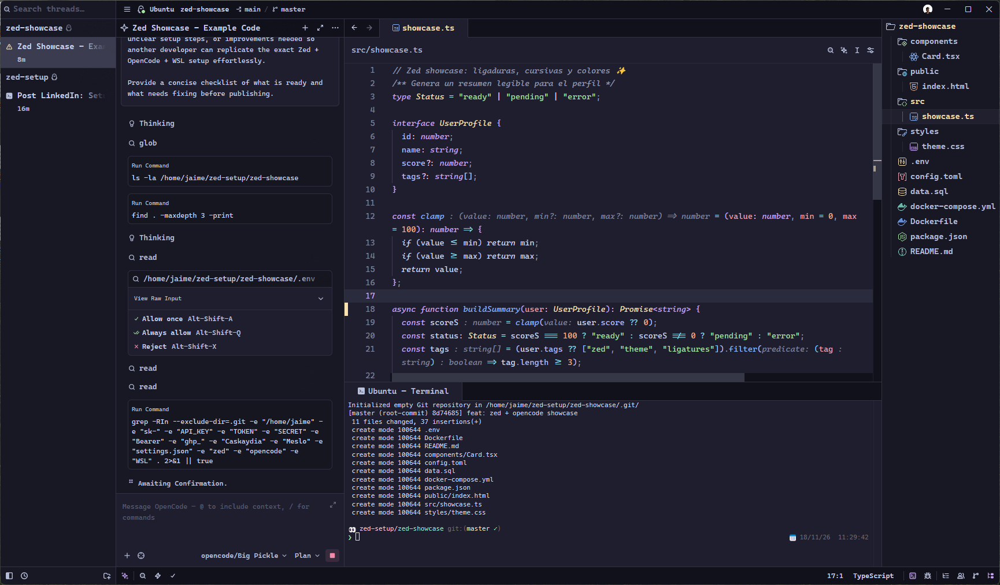

# Mi configuración de Zed

<p align="center">
  <em>Catppuccin Mocha · Ligaduras · VS Code keymap · OpenCode (ACP)</em>
</p>

<p align="center">
  <a href="https://zed.dev/"></a>
  <a href="https://github.com/catppuccin/catppuccin"></a>
  
  
</p>

<p align="center">
  
</p>

Este repositorio contiene mi configuración personal de [Zed](https://zed.dev/), el editor de código moderno, rápido y con enfoque en la colaboración y la IA. Lo comparto como parte de mi descubrimiento de Zed para que cualquier persona —incluso si nunca lo ha probado— pueda replicar mi entorno en pocos minutos.

---

## Índice

- [Inicio rápido](#inicio-rápido)
- [Ramas del repositorio](#ramas-del-repositorio)
- [¿Qué es Zed?](#qué-es-zed)
- [¿Qué incluye esta configuración?](#qué-incluye-esta-configuración)
- [Contenido del repositorio](#contenido-del-repositorio)
- [1. Instalar las fuentes](#1-instalar-las-fuentes-recomendado)
- [2. Abrir el archivo de configuración de Zed](#2-abrir-el-archivo-de-configuración-de-zed-settingsjson)
- [3. Aplicar esta configuración](#3-aplicar-esta-configuración)
- [4. Explicación de cada sección de `settings.json`](#4-explicación-de-cada-sección-de-settingsjson)
- [Notas finales](#notas-finales)

---

## Inicio rápido

1. **Instala las fuentes** incluidas en [`fonts/`](./fonts/) (recomendado para ligaduras e iconos).
2. Abre Zed y ejecuta `zed: open settings` desde la paleta de comandos (`Ctrl/Cmd + Shift + P`).
3. Copia el contenido de [`settings.json`](./settings.json) en tu configuración de Zed.
4. **Reinicia Zed** para cargar fuentes y extensiones.

> [!TIP]
> Si ya tienes configuración propia, haz una copia de seguridad de tu `settings.json` antes de reemplazarlo o copia solo las secciones que te interesen.

---

## Ramas del repositorio

| Rama | Finalidad | Contenido principal |
| --- | --- | --- |
| [`main`](https://github.com/Jaimemg03/zed-setup/tree/main) | **Setup** listo para usar | `settings.json`, `fonts/`, `README.md` |
| [`showcase`](https://github.com/Jaimemg03/zed-setup/tree/showcase) | **Demo/capturas** | Todo lo de `main` + `zed-showcase/` con un archivo en foco (`src/showcase.ts`) para mostrar ligaduras, iconos, cursivas y más |

---

## ¿Qué es Zed?

Zed es un editor de código de alto rendimiento creado por los autores de Atom y Tree-sitter. Destaca por su velocidad, su interfaz minimalista, su integración nativa con Git y su soporte para asistentes de IA.

Si aún no lo tienes instalado, puedes descargarlo desde: [zed.dev/download](https://zed.dev/download)

## ¿Qué incluye esta configuración?

- **Tema**: Catppuccin Mocha (claro/oscuro según el sistema) con iconos Catppuccin Mocha.
- **Sensación tipo VS Code**: atajos `VSCode`, sin modo Vim, formateo al guardar y autoguardado.
- **Tipografía con ligaduras**: `CaskaydiaCove Nerd Font` para la interfaz y el editor, y `MesloLGS NF` para la terminal integrada.
- **Mejoras visuales**: colorizado de paréntesis, resaltado de selección, guías de indentación, cursivas en comentarios/palabras clave y *inlay hints*.
- **Integración con Git**: estado en pestañas y panel de proyecto, e *inline blame* activado.
- **Agente de IA**: configuración de OpenCode mediante ACP (requiere configuración adicional, ver más abajo).
- **Extensiones automáticas**: instala automáticamente tema, iconos y extensiones de lenguajes/herramientas comunes.
- **Conexión WSL**: ejemplo preconfigurado para Ubuntu (útil en Windows con WSL).

## Contenido del repositorio

```text
.
├── assets/             # capturas/recursos visuales (opcional)
├── fonts/
│   ├── CaskaydiaCove/  # fuente para editor e interfaz
│   └── MesloLGS/       # fuente para terminal integrada
├── settings.json       # configuración de Zed
└── README.md
```

- `settings.json`: archivo de configuración listo para copiar en Zed.
- `fonts/`: fuentes incluidas para conservar el mismo aspecto visual (editor y terminal).
- `assets/`: espacio recomendado para capturas del setup (por ejemplo, `screenshot.png`).

---

## 1. Instalar las fuentes (recomendado)

Esta configuración usa fuentes con ligaduras e iconos Nerd Font. Si no las instalas, Zed usará una fuente alternativa y el resultado visual no será el mismo.

### Fuentes incluidas

- **Editor e interfaz**: `CaskaydiaCove Nerd Font` (carpeta `fonts/CaskaydiaCove/`)
- **Terminal integrada**: `MesloLGS NF` (carpeta `fonts/MesloLGS/`)

> [!NOTE]
> Las ligaduras son combinaciones visuales de caracteres (por ejemplo `=>`, `!=`, `===`) que hacen el código más legible sin cambiar su contenido.

### Cómo instalarlas

<details>
<summary><strong>Windows</strong></summary>

1. Abre la carpeta `fonts/CaskaydiaCove/`, selecciona todos los archivos `.ttf`, haz clic derecho y elige **Instalar** (o **Instalar para todos los usuarios**).
2. Repite el proceso con la carpeta `fonts/MesloLGS/`.
3. Reinicia Zed si ya estaba abierto.

</details>

<details>
<summary><strong>macOS</strong></summary>

1. Abre la carpeta `fonts/CaskaydiaCove/` y haz doble clic en los archivos `.ttf` para abrirlos en **Catálogo Tipográfico** (Font Book). Pulsa **Instalar**.
2. Repite el proceso con `fonts/MesloLGS/`.
3. También puedes copiar las fuentes a `~/Library/Fonts/`.
4. Reinicia Zed si ya estaba abierto.

</details>

<details>
<summary><strong>Linux</strong></summary>

1. Crea la carpeta de fuentes del usuario si no existe:
   ```bash
   mkdir -p ~/.local/share/fonts
   ```
2. Copia las fuentes del repositorio:
   ```bash
   cp -r fonts/CaskaydiaCove ~/.local/share/fonts/
   cp -r fonts/MesloLGS ~/.local/share/fonts/
   ```
3. Actualiza la caché de fuentes:
   ```bash
   fc-cache -fv
   ```
4. Reinicia Zed si ya estaba abierto.

</details>

## 2. Abrir el archivo de configuración de Zed (`settings.json`)

Si nunca has usado Zed, estos son los pasos para abrir tu configuración:

1. Abre Zed.
2. Abre la **paleta de comandos**:
   - **Windows/Linux**: `Ctrl + Shift + P`
   - **macOS**: `Cmd + Shift + P`
3. Escribe **`zed: open settings`** y selecciónalo.
4. Zed abrirá tu archivo `settings.json` personal.

### Ubicación del archivo `settings.json` (según sistema operativo)

Si prefieres abrirlo manualmente desde tu explorador o terminal:

| Sistema | Ruta |
| --- | --- |
| Linux | `~/.config/zed/settings.json` |
| macOS | `~/Library/Application Support/Zed/settings.json` |
| Windows | `%APPDATA%\Zed\settings.json` |

## 3. Aplicar esta configuración

1. Abre el archivo [`settings.json`](./settings.json) de este repositorio.
2. Copia todo su contenido.
3. Pégalo en tu `settings.json` de Zed (abierto con `zed: open settings`).
4. Guarda el archivo.
5. Reinicia Zed (o espera a que aplique los cambios) para que se instalen las extensiones y se carguen las fuentes.

> [!TIP]
> Puedes copiar solo las secciones que te interesen si prefieres mantener parte de tu configuración actual.

---

## 4. Explicación de cada sección de `settings.json`

A continuación se explica qué hace cada apartado para que sepas qué estás aplicando.

<details>
<summary><strong>1) Apariencia, tema e iconos</strong></summary>

- `theme`: usa **Catppuccin Mocha** tanto en modo claro como oscuro (`mode: system` sigue el tema del sistema).
- `icon_theme`: aplica iconos **Catppuccin Mocha** en el explorador y pestañas.
- `colorize_brackets`: colorea los pares de paréntesis/llaves para identificar bloques más fácilmente.
- `selection_highlight`: resalta otras apariciones del texto seleccionado.

**Dónde verlo en Zed:** cambios visibles de inmediato en la interfaz, pestañas y editor. También puedes explorar temas desde la paleta de comandos con `theme selector: toggle`.

</details>

<details>
<summary><strong>2) Tipografía y ligaduras</strong></summary>

- `ui_font_family` / `ui_font_size` / `ui_font_weight`: fuente y tamaño de la interfaz de Zed.
- `buffer_font_family` / `buffer_font_size` / `buffer_font_weight`: fuente y tamaño del editor (donde escribes código).
- `buffer_font_features`: activa ligaduras y características tipográficas (`calt`, `liga`, `zero`, `cv01`).

**Requisito:** tener instalada `CaskaydiaCove Nerd Font` (incluida en `fonts/CaskaydiaCove/`).

</details>

<details>
<summary><strong>3) Resaltado de sintaxis (cursivas)</strong></summary>

- `experimental.theme_overrides.syntax`: aplica estilo *italic* a comentarios, palabras clave (`if`, `return`, etc.), tipos y funciones.

> [!NOTE]
> Es un ajuste estético experimental; su comportamiento puede variar en futuras versiones de Zed.

</details>

<details>
<summary><strong>4) Comportamiento del editor (estilo VS Code)</strong></summary>

- `base_keymap: "VSCode"`: usa atajos de teclado similares a Visual Studio Code.
- `vim_mode: false`: desactiva el modo Vim.
- `tab_size: 2`: indentación de 2 espacios.
- `soft_wrap: "editor_width"`: ajusta líneas largas al ancho del editor.
- `preferred_line_length: 100` y `show_wrap_guides: true`: muestra una guía visual de longitud de línea.
- `format_on_save: "on"`: formatea el archivo al guardar (según el formateador disponible para el lenguaje).
- `remove_trailing_whitespace_on_save: true`: elimina espacios al final de las líneas al guardar.
- `autosave.after_delay` (1000 ms): guarda automáticamente tras 1 segundo de inactividad.
- `inlay_hints.enabled: true`: muestra pistas en línea (tipos/parámetros) cuando el lenguaje/servidor lo soporta.
- `indent_guides`: muestra guías de indentación con color según nivel.

**Cómo probarlo:** abre cualquier archivo de código, escribe, guarda y observa el formateo/autoguardado, guías y ajuste de línea.

</details>

<details>
<summary><strong>5) Interfaz, pestañas y Git</strong></summary>

- `tabs.file_icons` y `tabs.git_status`: muestra iconos de archivo y estado de Git en las pestañas.
- `preview_tabs`: permite abrir archivos en vista previa (por ejemplo, desde el buscador de archivos).
- `project_panel.auto_fold_dirs: false`: evita que el panel de proyecto colapse carpetas automáticamente.
- `project_panel.git_status`: muestra estado de Git en el árbol de archivos.
- `git.inline_blame.enabled: true`: muestra información de *blame* en línea (autor/commit) en el editor.

**Dónde verlo:** panel lateral de proyecto, pestañas y líneas del editor dentro de un repositorio Git.

</details>

<details>
<summary><strong>6) Terminal integrada</strong></summary>

- `terminal.font_family`: usa `MesloLGS NF` en la terminal integrada.
- `terminal.font_fallbacks`: fuentes alternativas si la principal no está disponible.
- `terminal.font_size`: tamaño de fuente de la terminal.

**Requisito:** tener instalada `MesloLGS NF` (incluida en `fonts/MesloLGS/`).

**Cómo abrir la terminal en Zed:** usa la paleta de comandos (`Ctrl/Cmd + Shift + P`) y busca "terminal", o usa el panel/atajo de terminal de tu instalación.

</details>

<details>
<summary><strong>7) Agentes de IA (OpenCode vía ACP)</strong></summary>

Esta configuración incluye un agente personalizado llamado **OpenCode** configurado mediante ACP:

- `agent.flexible: true`: habilita opciones flexibles del agente.
- `agent_servers.OpenCode`: define el servidor del agente con:
  - `command: "opencode"`
  - `args: ["acp"]`
  - `default_config_options.mode: "plan"`
  - `env.OPENCODE_API_KEY: "TU_OPENCODE_API_KEY"`

> [!IMPORTANT]
> **Antes de usarlo:**
> 1. Instala [OpenCode](https://opencode.ai/) y asegúrate de que `opencode` esté disponible en tu `PATH`.
> 2. Reemplaza `"TU_OPENCODE_API_KEY"` por tu clave real en `settings.json`.
> 3. Si no vas a usar OpenCode, puedes eliminar o comentar esta sección.

> [!WARNING]
> No compartas públicamente tu clave real. Si publicas tu configuración, deja siempre un valor de ejemplo como `TU_OPENCODE_API_KEY`.

</details>

<details>
<summary><strong>8) Extensiones autoinstalables</strong></summary>

- `auto_install_extensions`: indica a Zed que instale automáticamente extensiones al iniciar (si no están ya instaladas).

Incluye, entre otras:
- **Tema e iconos**: `catppuccin`, `catppuccin-icons`
- **Lenguajes y formatos**: `html`, `dockerfile`, `docker-compose`, `env`, `toml`, `sql`, `xml`
- **Herramientas y productividad**: `emmet`, `biome`, `comment`, `emoji-completions`, `git-firefly`

> [!NOTE]
> La primera vez que abras Zed con esta configuración, puede tardar unos momentos en descargar e instalar las extensiones.

</details>

<details>
<summary><strong>9) Conexiones remotas (WSL)</strong></summary>

- `wsl_connections`: incluye un ejemplo de conexión a la distro `Ubuntu` en WSL.

> [!NOTE]
> Esta sección es útil principalmente para usuarios de **Windows** con **WSL (Windows Subsystem for Linux)**. Si no usas WSL, puedes eliminarla o adaptarla a tu entorno.

</details>

<details>
<summary><strong>10) Sesión y privacidad</strong></summary>

- `session.trust_all_worktrees: true`: confía automáticamente en los *worktrees* abiertos.
- `telemetry.diagnostics: true`: permite envío de diagnósticos.
- `telemetry.metrics: false`: desactiva métricas.
- `telemetry.anthropic_retention: false`: desactiva la retención de datos asociada a Anthropic (según esta opción de configuración).

> [!TIP]
> Revisa y ajusta estas opciones según tus preferencias de privacidad y confianza en los proyectos que abras.

</details>

---

## Notas finales

- Esta configuración está pensada para ofrecer una experiencia familiar (estilo VS Code) con una estética cuidada y lista para trabajar.
- Si algo no se ve igual, revisa que las fuentes estén instaladas y que Zed se haya reiniciado.
- Si usas otro sistema operativo o no necesitas WSL/OpenCode, adapta o elimina esas secciones sin problema.
- El archivo `settings.json` usa comentarios (`//`, estilo JSONC), que Zed acepta aunque no formen parte del JSON estricto.

---

<p align="center">
  Si este repositorio te resulta útil, puedes usarlo como punto de partida y personalizarlo a tu gusto.
</p>
